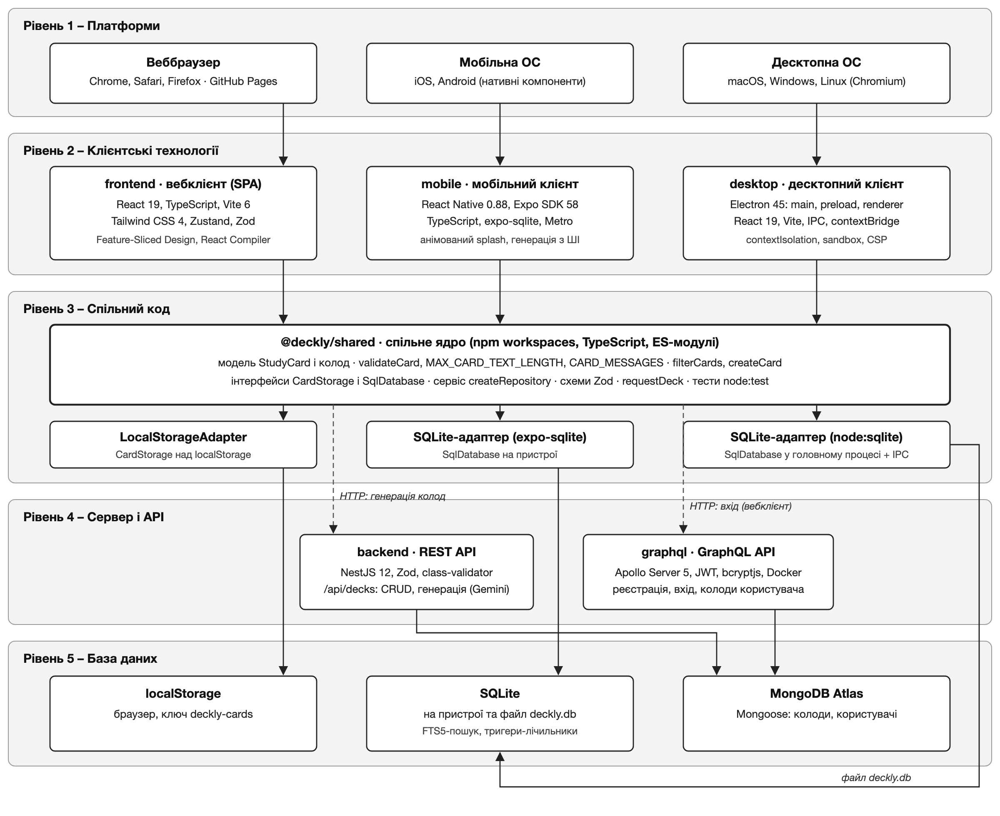

# ai-card-generator

A spaced-repetition app: type a topic, get an AI-generated deck and review it in one of three modes, while the review schedule is computed with the FSRS algorithm. Light and dark themes, responsive layout and animated transitions.

The repository is an npm workspaces monorepo: a shared core in `shared/`, three clients (`frontend/` web, `mobile/` React Native, `desktop/` Electron) and two APIs (`backend/` NestJS REST, `graphql/` Apollo Server).

<div align="center">


</div>

## Features

- Three review modes: card flip, question-and-answer graded with FSRS, and true/false with instant feedback
- Deck generation from a topic in Ukrainian or English
- Decks stored in MongoDB through a REST API with full CRUD
- FSRS-style review scheduling: Again / Hard / Good / Easy
- Light and dark themes with saved preference
- Responsive layout for desktop and mobile
- 3D card flip and entrance animations that respect `prefers-reduced-motion`

## Structure

```
shared/     @deckly/shared: card model, validation, search, storage interfaces, repository
frontend/   React 19 + Vite web app, Feature-Sliced Design
mobile/     React Native + Expo app with SQLite storage
desktop/    Electron app with SQLite storage
backend/    NestJS REST API, MongoDB, deck generation
graphql/    Apollo Server GraphQL API with JWT auth
.github/    GitHub Pages deploy of the frontend
```

`shared`, `frontend`, `mobile` and `desktop` are npm workspaces: the clients import the core as `@deckly/shared` and plug in their own storage adapters. `backend` and `graphql` are standalone packages reached over HTTP.

### Frontend

Feature-Sliced Design — imports only flow "down": `app → pages → widgets → features → entities → shared`.

```
frontend/src/
  app/        theme provider, global styles and tokens, entry point
  pages/      landing
  widgets/    site-header, hero, feature-list, review-demo
  features/   generate-deck, rate-card (FSRS)
  entities/   card, deck
  shared/     ui (Button, Chips, Backdrop, GlassPanel, icons), lib (cn)
```

### Backend

NestJS modules with SOLID layering and the repository pattern: controllers call services, services reach MongoDB only through repository interfaces. Architecture, folder rules and the API are in [`backend/README.md`](backend/README.md).

## Getting started

Frontend — generation needs the backend running; the API address comes from `VITE_API_URL` and defaults to `http://localhost:3000/api`:

```bash
cd frontend
npm install && npm run dev
```

Backend — requires a MongoDB connection string (for example a free MongoDB Atlas cluster):

```bash
cd backend
npm install
cp .env.example .env
npm run dev
```

Build and type-check either package with `npm run build` from its folder.

## Технологічний стек і компетентності

Deckly працює у браузері, на телефоні та на комп’ютері. Правила роботи з картками для всіх трьох клієнтів написані один раз, у спільному ядрі.



### Стек технологій

| Рівень | Технології | Де реалізовано |
| --- | --- | --- |
| 1. Платформи | Веббраузер (GitHub Pages), iOS і Android, macOS, Windows і Linux | [`frontend/`](frontend), [`mobile/`](mobile), [`desktop/`](desktop) |
| 2. Клієнтські технології | React 19, Vite, Tailwind CSS 4, Zustand; React Native 0.88, Expo SDK 58; Electron 45 | [`frontend/src`](frontend/src), [`mobile/components`](mobile/components), [`desktop/src`](desktop/src) |
| 3. Спільний код | `@deckly/shared`, npm workspaces, адаптери localStorage, expo-sqlite і node:sqlite, тести `node:test` | [`shared/`](shared), [`local-storage-adapter.ts`](frontend/src/pages/cards/model/local-storage-adapter.ts), [`mobile/db`](mobile/db), [`desktop/src/main`](desktop/src/main) |
| 4. Сервер і API | NestJS REST API з генерацією колод через Gemini; Apollo Server GraphQL з JWT | [`backend/`](backend), [`graphql/`](graphql) |
| 5. База даних | MongoDB Atlas (Mongoose), SQLite з FTS5, localStorage | [`backend/src/decks`](backend/src/decks), [`shared/storage`](shared/storage), [`graphql/db.ts`](graphql/db.ts) |

### Сильні сторони проєкту

- **Одне ядро на три клієнти.** Перевірку, пошук і тексти повідомлень визначає [`shared/study-cards`](shared/study-cards). Якщо змінити ліміт довжини в ядрі, нове правило одразу діє і у вебверсії, і в Electron.
- **Адаптери збереження.** Сервіс [`createRepository`](shared/storage/repository.ts) отримує SQL-адаптер ззовні: у десктопі це `node:sqlite`, на телефоні `expo-sqlite`, у тестах база в пам’яті.
- **Безпечний десктоп.** Вікно Electron працює з `contextIsolation`, `sandbox` і CSP. Сторінка бачить лише `window.cardsAPI`, а дані з рендер-процесу перевіряє [`handlers.ts`](desktop/src/main/handlers.ts).
- **Генерація колод з ШІ.** Мобільний і десктопний клієнти використовують спільний запит [`requestDeck`](shared/decks/request.ts) з тайм-аутом і скасуванням, а вебклієнт бере з ядра адресу та параметри генерації. Відповідь сервера перевіряється схемами Zod.

### Історія проєкту

| | |
| --- | --- |
| **Назва проєкту** | Deckly – навчальні картки з інтервальним повторенням і генерацією колод за допомогою ШІ |
| **Проблема** | Студентам і всім, хто вивчає мови чи терміни, довго складати картки вручну. Deckly генерує колоду за темою, а повторювати її можна там, де зручно: у браузері, на телефоні або на комп’ютері без інтернету |
| **Моя роль і внесок** | Повний цикл розробки: архітектура, вебклієнт, мобільний і десктопний клієнти, REST і GraphQL API, спільне ядро, тести, CI для GitHub Pages |
| **Обраний стек** | TypeScript на всіх рівнях, тому типи та правила ядра переходять між клієнтами без змін. React дає один підхід до інтерфейсу у вебі, на телефоні (React Native) і в Electron. SQLite на пристроях працює офлайн і має повнотекстовий пошук. MongoDB зберігає документи колод у тій самій формі, у якій їх повертає модель ШІ |
| **Найскладніший виклик і рішення** | Один пакет TypeScript мали однаково розуміти Vite, Metro і Node.js. Ядро стало workspace-пакетом із полем `exports` і явними розширеннями `.ts`, тому тести запускаються без компіляції. У Metro модуль `react` прив’язано до копії мобільного клієнта: React Native зібраний під іншу версію React, ніж десктоп |
| **Здобуті знання та вміння** | Проєктую монорепозиторій зі спільним ядром і платформними адаптерами. Будую SPA на React, мобільний застосунок на React Native і десктопний на Electron з безпечним IPC. Створюю REST API на NestJS і GraphQL API з JWT. Працюю з MongoDB і SQLite, тестую спільний код через `node:test` |

### Що я знаю та вмію

- Розділяю код на платформонезалежне ядро і платформні адаптери, налаштовую npm workspaces.
- Розробляю клієнти для вебу, мобільних ОС і десктопу на одному стеку React і TypeScript.
- Проєктую REST і GraphQL API, реалізую автентифікацію через JWT і валідацію даних Zod.
- Обираю сховище під платформу: localStorage, SQLite з FTS5 або MongoDB.
- Покриваю спільну логіку автоматичними тестами і перевіряю, що зміна в ядрі діє в усіх клієнтах.

Репозиторій: https://github.com/chupikx228/ai-card-generator
