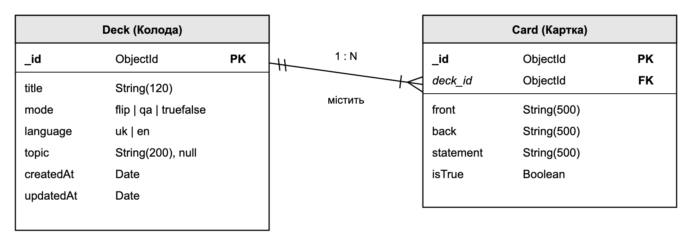
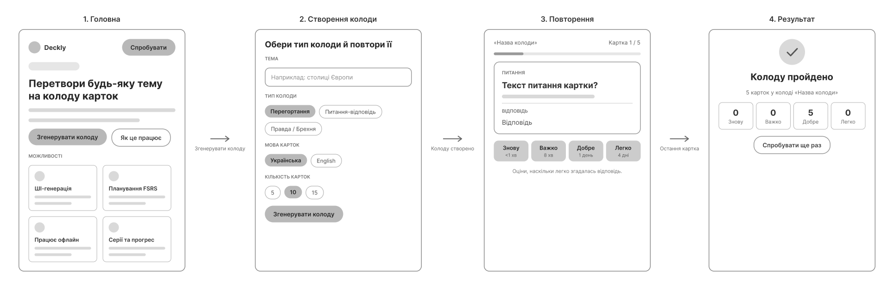
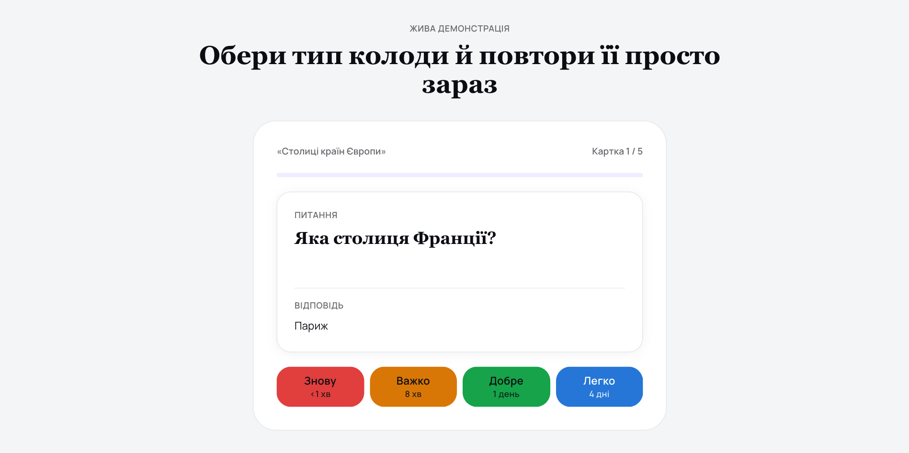

# Лабораторна робота № 3: архітектурне та UX/UI-проєктування Deckly

### Архітектурний стиль і діаграма

Обрано трирівневу клієнт-серверну архітектуру: React SPA у браузері, сервер на NestJS і рівень даних із MongoDB Atlas та Google Gemini API. Сервер поділено на рівні контролера, сервісу та репозиторію, а доступ до БД і LLM винесено за інтерфейси DecksRepository і CardGenerator. Такий стиль тримає ключі доступу на сервері, централізує валідацію і простіший у супроводі, ніж мікросервіси.

### ER-діаграма

Модель даних містить дві сутності: Deck (колода) і Card (картка) зі зв'язком 1:N. Колода має назву, режим (flip, qa, truefalse), мову, тему та часові мітки. У MongoDB картки зберігаються як вкладені документи колоди, тому зовнішній ключ deck_id логічний.

### Каркас (Wireframe)

Каркас створено у Figma з локальних компонентів: кнопок, чипів, карток і кнопок оцінювання. Він показує чотири екрани основного сценарію: головна, створення колоди, повторення та результат, а стрілки задають переходи між ними.

### Макет (Mockup)

Макет показує фінальний вигляд екрана повторення: питання, відповідь і чотири кнопки оцінювання FSRS з інтервалами наступного показу. Кольори кнопок відповідають складності згадування, від «Знову» до «Легко».
