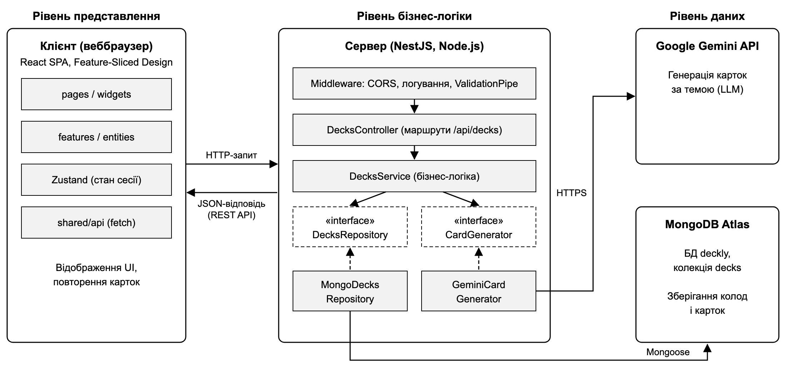

# Лабораторна робота № 3: архітектурне та UX/UI-проєктування Deckly

### Архітектурний стиль і діаграма

Обрано трирівневу клієнт-серверну архітектуру: React SPA у браузері, сервер на NestJS і рівень даних із MongoDB Atlas та Google Gemini API. Сервер поділено на рівні контролера, сервісу та репозиторію, а доступ до БД і LLM винесено за інтерфейси DecksRepository і CardGenerator. Такий стиль тримає ключі доступу на сервері, централізує валідацію і простіший у супроводі, ніж мікросервіси.
